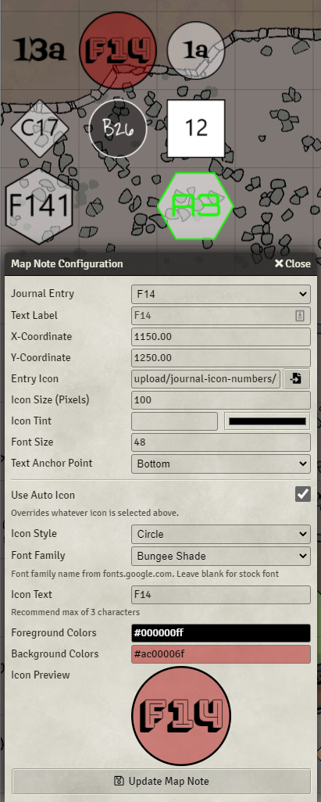

# Nik's Journal Icon Numbers


**Nik's Journal Icon Numbers** gives map notes numbered icons automatically. Drag a journal entry called
"12 Tavern" or "A3 Guard Room" onto the map, and its note gets an icon showing "12" or "A3", in the shape, colors
and font you chose.

Based on [Automatic Journal Icon Numbers](https://github.com/tcflanag/journal_icon_numbers) by Chris Flanagan
(MIT license).



---

## Compatibility

- **Foundry VTT**: V14 (14.370 or newer)
- **System**: D&D 5e 6.1
- **Languages**: English and German.
- No other modules needed.

---

## Features

### Automatic icons

When a map note is created for a journal entry or a journal page, the module looks at the start of the name and
picks the icon text from it. These formats are recognized (upper and lower case):

| Format | Example name | Icon text | On by default |
|---|---|---|---|
| Numbers and a letter | 23G Crypt | 23G | yes |
| A letter and numbers | A24 Hall | A24 | yes |
| Numbers | 123 Gate | 123 | yes |
| A letter and a space | Q Tower | Q | no |
| A letter and a period | Z. Bridge | Z | no |
| Numbers and a period | 123. Well | 123 | no |
| Your own pattern | | | no |

The note's text label wins over the page name, which wins over the journal entry name. Names like "1st Floor" give
"1", not "1s".

### Map note window

The **Map Note** window gets an **Automatic Icon** section below the icon settings:

- Turn the automatic icon on or off for this note. When it is off, the note uses the icon chosen above as usual.
- Change the icon text, shape, font, text size, border width and colors for this note only.
- A preview shows the icon as you change it.
- For a new note, the icon text follows the journal entry, page and text label you pick, until you edit it yourself.

The icon is saved as an SVG image in the upload folder when the note is saved.

### Default icon style

**Configure Settings → Nik's Journal Icon Numbers → Default Icon Style** sets the style new icons start with:

- **Shape**: circle, square, diamond, two hexagons, or none (text only).
- **Font**: the name of any font from [Google Fonts](https://fonts.google.com), for example "Roboto Slab", with bold
  and italics. Leave it empty for the default font. Only the characters of the icon are downloaded and stored inside
  the image, so the icon looks the same for everyone, even offline. If a font can't be found, the preview says so
  and the icon uses the default font. If Google Fonts is only temporarily unreachable, you get a warning, and
  **Rebuild Icons** adds the right font later.
- **Text size** and **border width**.
- **Text and border color** and **background color**, each with an opacity slider.
- **Icon size** of new map notes in grid squares (at least 32 pixels, Foundry's minimum), and the **label font size** of new map notes.

### Name matching

**Name Matching** turns the formats above on and off and lets you add your own pattern, with a test field that shows
the icon a name would get.

Your own pattern is a JavaScript [regular expression](https://developer.mozilla.org/en-US/docs/Web/JavaScript/Guide/Regular_Expressions):

- Leave out the surrounding slashes.
- Start with `^` to match from the start of the name.
- The last capture group becomes the icon text; without groups, the whole match does.
- Separate several patterns with `|`, for example `^\d:\d|^[a-zA-Z]\.\d{1,2}`.
- An invalid pattern is shown in red and ignored.

The built-in patterns are tried first, in the order shown, then your own.

### Other options

- **Icons from Folders**: a new note whose journal entry is in a folder named like a stock icon ("Village", "Cave",
  "Book" …) gets that icon. Automatic icons from the name win. On by default.
- **Icons from Image Pages**: a new note without an automatic icon uses the picture of its image page, or of the
  entry's first image page. Off by default.
- **Quick Add Mode**: when a new note gets its icon from this module, it is created right away without showing the
  Map Note window. Off by default.
- **Upload Folder**: where the icon images are saved (default `assets/niks-journal-icon-numbers` in your user data). Don't delete the
  images: the notes still use them.

### Rebuild icons

**Rebuild Icons** creates the images of all notes with an automatic icon again, in every scene. Choose **Keep each
note's style** to restore missing images (for example after moving the upload folder), or **Use the default style**
to give every note the current default style and size.

### Players

Players who may create map notes can use the automatic icons too. Saving the image needs the **Upload Files** and
**Browse File Explorer** permissions; for players without them, the GM's client creates the image, so a GM has to be
connected. If none is, the player is told, and the icon is created the next time a GM joins.

---

## Switching from Automatic Journal Icon Numbers

1. Deactivate **Automatic Journal Icon Numbers** and activate this module. While both are active, this module stays
   off and shows a warning, since the two would keep replacing each other's icons.
2. The first time a GM loads the world, the module copies the old module's settings and the automatic icon settings of
   every map note.
3. It also copies the icon images of all map notes from the old module's upload folder into this module's upload
   folder and points the notes at the copies. This covers world scenes and unlocked Scene compendiums. Missing images
   are created again from the note's settings. The old module's settings and files stay untouched.
4. If a locked compendium still uses the old images, a warning names it. Unlock it, then run this in the console as
   GM:

   ```js
   await game.modules.get("niks-journal-icon-numbers").api.migrateCompendiumIcons({force: true})
   ```

You can delete the old folder (`upload/journal-icon-numbers` by default) once no warning names a compendium. Scenes
inside **Adventure** compendiums aren't checked, so keep the folder if one of your Adventures uses these icons.

The upload folder setting of the old module isn't taken over: icons always move to this module's folder.

---

## For module developers

`game.modules.get("niks-journal-icon-numbers").api`:

- `matchLabel(label)`: the icon text for a name, or `null`.
- `getNoteFlags(note)`: the automatic icon settings of a note, filled up with the defaults.
- `applyIcon(note)`: create the icon of a note with an automatic icon and set it as the note's texture.
- `rebuildIcons({useDefaults})`: rebuild all icons, see above.
- `migrateCompendiumIcons({force})`: move old icon images used by unlocked Scene compendiums.

The settings of a note live in `flags["niks-journal-icon-numbers"]`: `autoIcon`, `iconText`, `iconType`, `foreColor`,
`backColor` (`#rrggbbaa`), `fontFamily`, `fontBold`, `fontItalics`, `strokeWidth`, `iconFontSize`. Changing them
updates the icon.

Debug logging: `CONFIG.debug.niksJournalIconNumbers = true`.

---

## Credits and license

Original module by Chris Flanagan, MIT license (see `LICENSE`). It is based on parts of
[vtta-dndbeyond](https://github.com/VTTAssets/vtta-dndbeyond/) and the Google font embedding of
[embedded-google-fonts](https://github.com/amio/embedded-google-fonts), both MIT.
